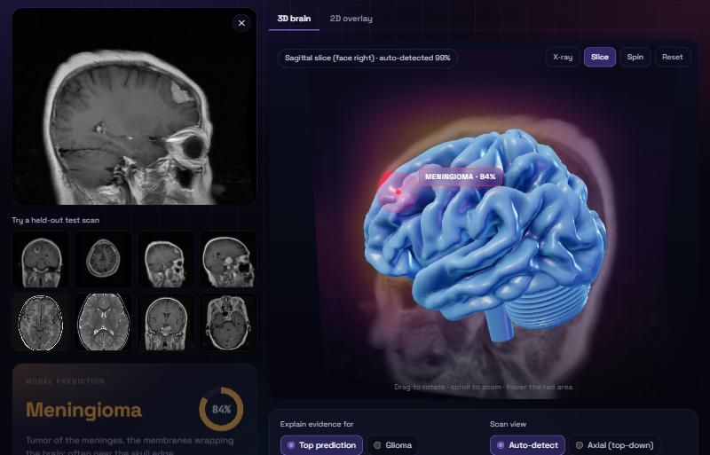
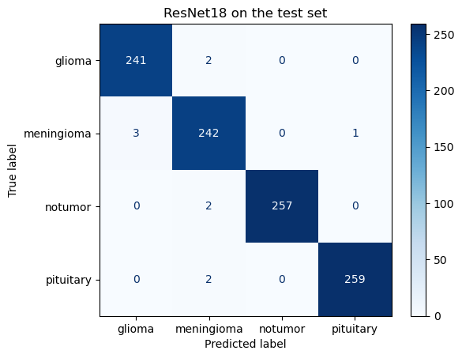
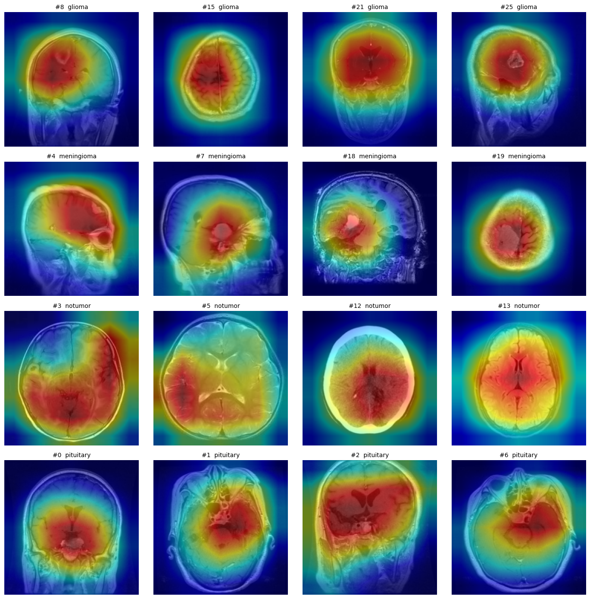
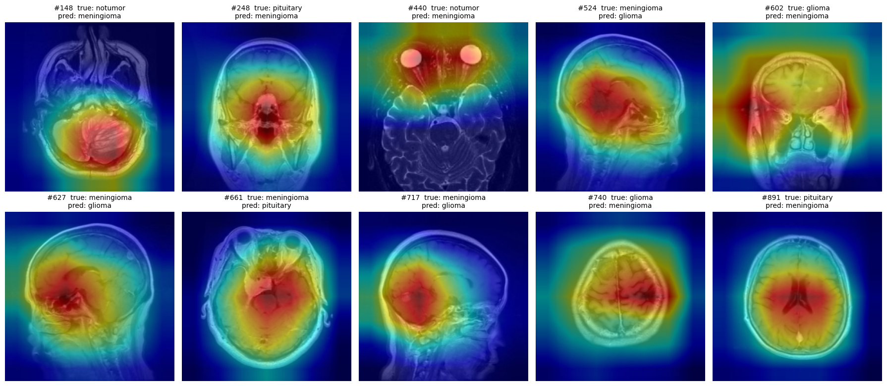

# Brain Tumor MRI Classification

A PyTorch image classifier that sorts brain MRI scans into four classes: **glioma, meningioma, pituitary tumor, and no tumor**. A fine-tuned ResNet18 reaches **99.0% accuracy on a held-out test set (999 / 1,009)** that was used once, after the model was chosen.

The project also checks whether that number can be trusted: it finds and removes duplicate scans that leaked between splits, uses Grad-CAM to see where the model looks, and audits a random sample for scan-view bias.

> This is a learning project, not a medical tool.

## Live demo

**[Try NeuroLens on Hugging Face](https://huggingface.co/spaces/prab12/neurolens)**: upload an MRI slice, see the
prediction, and explore where the model looked on an interactive 3D brain. The model runs entirely in your browser,
so scans never leave your device.



The heatmap is the same Grad-CAM as in the notebook. It is projected from the 2D slice onto a template brain, so
the 3D position is an estimate. Details, and how to run it locally, are in [`demo/`](demo/README.md).

## Results

| Model | Best val loss | Validation accuracy | Test accuracy |
|---|---|---|---|
| Baseline CNN (from scratch, 406,500 parameters) | 0.262 (epoch 10) | 91.8% | not tested |
| **ResNet18 (ImageNet weights, fine-tuned)** | **0.030 (epoch 9)** | **99.0%** | **99.0% (999 / 1,009)** |

The test set was evaluated once, with the final ResNet18 only.

**Per-class results on the test set**

| Class | Precision | Recall | Test scans |
|---|---|---|---|
| Glioma | 0.988 | 0.992 | 243 |
| Meningioma | 0.976 | 0.984 | 246 |
| No tumor | 1.000 | 0.992 | 259 |
| Pituitary | 0.996 | 0.992 | 261 |



- **No tumor scan was classified as "no tumor"** on the test set (zero false negatives). The two errors in the no-tumor row are healthy scans flagged as meningioma.
- **All 10 errors involve meningioma**, either as the true class or as the prediction. Glioma and meningioma are the hardest pair.

## Data

- Source: [Kaggle, `tombackert/brain-tumor-mri-data`](https://www.kaggle.com/datasets/tombackert/brain-tumor-mri-data), 7,153 images in four class folders.
- Images vary in size and channels (grayscale and RGB). All are converted to RGB and resized to 224×224.

### Duplicate scans and leakage

Hashing every file (MD5 of the raw bytes) showed that only 6,726 of the 7,153 images are unique: **427 are exact copies**. With the original random split, copies landed on both sides: 78 unique scans were shared between train and validation, and 79 between train and test. That is data leakage, since the model had already trained on some of the scans it was scored on.

| Class | Before | After | Removed |
|---|---|---|---|
| No tumor | 2,000 | 1,731 | 269 |
| Meningioma | 1,775 | 1,635 | 140 |
| Pituitary | 1,757 | 1,740 | 17 |
| Glioma | 1,621 | 1,620 | 1 |

- No duplicate had conflicting labels.
- Duplicates are removed **before** splitting, so each scan can only land in one split. The clean split (70 / 15 / 15, stratified, seed 42) is 4,708 / 1,009 / 1,009, and a hash check confirms zero overlap between splits.
- The leak mattered most for the weaker model: the baseline CNN scored 94.4% validation accuracy on the leaky split and 91.8% on the clean one.

## Method

- **Pipeline:** custom PyTorch `Dataset` and `DataLoader`s (batch size 32). Training images get random horizontal flips and ±10° rotations; validation and test images do not. All images use ImageNet normalization.
- **Baseline CNN:** two conv blocks (Conv → ReLU → MaxPool), then one linear layer. Adam, learning rate 1e-3, 10 epochs.
- **ResNet18:** ImageNet-pretrained weights with the final layer replaced by a 4-class layer. All layers fine-tuned with Adam at learning rate 1e-4 (smaller, so the pretrained features are adjusted rather than overwritten), 10 epochs.
- **Model selection:** each run keeps the epoch with the lowest validation loss. A 5-epoch and a 10-epoch ResNet18 run reached about the same validation result (0.027 and 0.030 val loss), so longer training did not help.
- Trained on an NVIDIA RTX 3050 Laptop GPU (6 GB).

## Does the model look at the tumor? (Grad-CAM)

Grad-CAM heatmaps on the last convolutional block (`layer4`) show which regions drove each prediction. Red means most important.

**Correct predictions, 4 per class:**



On tumor scans, the heat usually sits on the visible mass. On no-tumor scans it is spread across the brain, which fits: there is no single spot that proves the absence of a tumor.

**All 10 test errors:**



- In 8 of 10 errors the heat is inside the brain, mostly on genuinely ambiguous glioma ↔ meningioma cases.
- Two errors show shortcuts: in **#440**, a low slice through the eye sockets, the model focused on the bright eyeballs and called a healthy scan meningioma. In **#602** the heat sits on the skull edge rather than brain tissue.
- The 10 errors are spread across views (5 axial, 2 coronal, 3 sagittal).

## Scan-view audit

MRI scans come in three views: axial (top-down), coronal (from the front) and sagittal (from the side). If one class came mostly from one view, the model could learn the view instead of the tumor. I hand-labeled the view of a random sample of 20 test scans per class (80 total).

| Class | Axial | Coronal | Sagittal |
|---|---|---|---|
| Glioma | 9 | 7 | 4 |
| Meningioma | 5 | 4 | 11 |
| No tumor | **18** | 2 | **0** |
| Pituitary | 11 | 2 | 7 |

- The data is strongly view-imbalanced: 18 of 20 sampled no-tumor scans are axial, and none are sagittal.
- The model does not simply treat "axial" as "no tumor": **all 25 axial tumor scans in the sample were classified correctly** (exact 95% confidence interval: about 86% to 100%).
- Accuracy in the sample by view: axial 42/43, coronal 15/15, sagittal 22/22. The one axial error is #440, a healthy scan called meningioma.

## Limitations

1. **The no-tumor class appears to come from different sources.** Many no-tumor images look different in style (bright-fluid scan types, one image that looks like a CT scan rather than an MRI, rulers, arrows and text burned into a few images). The model may partly separate no-tumor scans by style, which the view audit cannot rule out. Performance on healthy scans from the same scanners as the tumor scans could be lower.
2. **View imbalance.** No-tumor scans are mostly axial. The audit suggests the model does not rely on view, but it is based on a sample of 80.
3. **Square resize.** Every image is stretched to 224×224, which distorts scans that are not square.
4. **Only exact duplicates were removed.** Near-duplicates (the same scan resized, cropped or re-saved) would not match by hash and may remain.
5. **One training run per model.** Differences under about 1% between runs are within normal run-to-run variation.
6. **Not a medical tool.** Test performance on one public dataset says nothing about performance on real patients.

## Repository

```
brain_mri_cnn.ipynb   full notebook, with outputs
figures/              plots used in this README
requirements.txt      Python packages for the notebook
demo/                 NeuroLens: browser and Gradio demo (see demo/README.md)
```

The dataset and trained weights (`*.pt`) are not included (see `.gitignore`). Download the dataset from Kaggle, set `data_path` in the notebook, and run the cells in order. To run the demo locally, copy the saved `resnet18_best.pt` into `demo/weights/`.

## Next steps

- Check for near-duplicates with perceptual hashing.
- Collect or find no-tumor scans in the same style as the tumor scans, and test whether no-tumor precision holds.
- Repeat training with several seeds and report the spread.
- ~~A small Gradio demo that shows the prediction and its Grad-CAM heatmap.~~ Done: see [Live demo](#live-demo).
