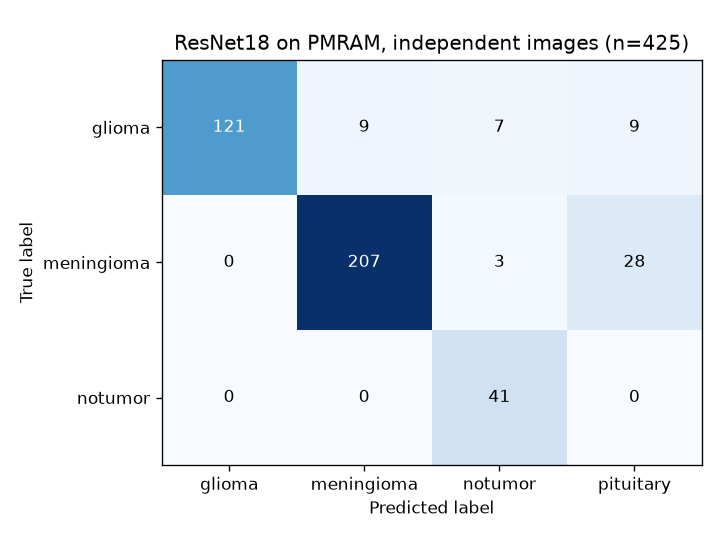

# Brain Tumor MRI Classification

A PyTorch image classifier that sorts brain MRI scans into four classes: **glioma, meningioma, pituitary tumor, and no tumor**. A fine-tuned ResNet18 reaches **99.0% accuracy on a held-out test set (999 / 1,009)** that was used once, after the model was chosen.

The project also checks whether that number can be trusted: it finds and removes duplicate scans that leaked between splits, uses Grad-CAM to see where the model looks, and audits a random sample for scan-view bias.

On independent scans from another dataset, that model dropped to 86.8%. **Version 2** crops each scan to the head and trains with stronger augmentation: it keeps 99.0% on the test set and reaches **97.9% on the independent scans** ([details](#v2-closing-the-gap-on-outside-scans)).

> This is a learning project, not a medical tool.

## Live demo

**[Try NeuroLens on Hugging Face](https://huggingface.co/spaces/prab12/neurolens)**: upload an MRI slice, see the
prediction, and explore where the model looked on an interactive 3D brain. The model runs entirely in your browser,
so scans never leave your device.


The demo runs the v2 model. The heatmap is Grad-CAM, as in the notebook, projected from the 2D slice onto a
template brain, so the 3D position is an estimate. Details, and how to run it locally, are in [`demo/`](demo/README.md).

## Results

| Model | Best val loss | Validation accuracy | Test accuracy | Independent external scans |
|---|---|---|---|---|
| Baseline CNN (from scratch, 406,500 parameters) | 0.262 (epoch 10) | 91.8% | not tested | not tested |
| ResNet18 v1 (ImageNet weights, fine-tuned) | 0.030 (epoch 9) | 99.0% | 99.0% (999 / 1,009) | 86.8% (369 / 425) |
| **ResNet18 v2 (+ head crop, stronger augmentation)** | **0.033 (epoch 10)** | **99.0%** | **99.0% (999 / 1,009)** | **97.9% (416 / 425)** |

The test set was evaluated once with v1, which the per-class results and the Grad-CAM and view sections below describe.
v2 was evaluated once on the test set and the external scans, with the decision rule fixed beforehand.

**Per-class results on the test set**

| Class | Precision | Recall | Test scans |
|---|---|---|---|
| Glioma | 0.988 | 0.992 | 243 |
| Meningioma | 0.976 | 0.984 | 246 |
| No tumor | 1.000 | 0.992 | 259 |
| Pituitary | 0.996 | 0.992 | 261 |


- **No tumor scan was classified as "no tumor"** on the test set (zero false negatives). The two errors in the no-tumor row are healthy scans flagged as meningioma.
- **All 10 errors involve meningioma**, either as the true class or as the prediction. Glioma and meningioma are the hardest pair.

## Data

- Source: [Kaggle, `tombackert/brain-tumor-mri-data`](https://www.kaggle.com/datasets/tombackert/brain-tumor-mri-data), 7,153 images in four class folders.
- Images vary in size and channels (grayscale and RGB). All are converted to RGB and resized to 224×224.

### Duplicate scans and leakage

Hashing every file (MD5 of the raw bytes) showed that only 6,726 of the 7,153 images are unique: **427 are exact copies**. With the original random split, copies landed on both sides: 78 unique scans were shared between train and validation, and 79 between train and test. That is data leakage, since the model had already trained on some of the scans it was scored on.

| Class | Before | After | Removed |
|---|---|---|---|
| No tumor | 2,000 | 1,731 | 269 |
| Meningioma | 1,775 | 1,635 | 140 |
| Pituitary | 1,757 | 1,740 | 17 |
| Glioma | 1,621 | 1,620 | 1 |

- No duplicate had conflicting labels.
- Duplicates are removed **before** splitting, so each scan can only land in one split. The clean split (70 / 15 / 15, stratified, seed 42) is 4,708 / 1,009 / 1,009, and a hash check confirms zero overlap between splits.
- The leak mattered most for the weaker model: the baseline CNN scored 94.4% validation accuracy on the leaky split and 91.8% on the clean one.

## Method

- **Pipeline:** custom PyTorch `Dataset` and `DataLoader`s (batch size 32). Training images get random horizontal flips and ±10° rotations; validation and test images do not. All images use ImageNet normalization.
- **Baseline CNN:** two conv blocks (Conv → ReLU → MaxPool), then one linear layer. Adam, learning rate 1e-3, 10 epochs.
- **ResNet18:** ImageNet-pretrained weights with the final layer replaced by a 4-class layer. All layers fine-tuned with Adam at learning rate 1e-4 (smaller, so the pretrained features are adjusted rather than overwritten), 10 epochs.
- **Model selection:** each run keeps the epoch with the lowest validation loss. A 5-epoch and a 10-epoch ResNet18 run reached about the same validation result (0.027 and 0.030 val loss), so longer training did not help.
- Trained on an NVIDIA RTX 3050 Laptop GPU (6 GB).

## Does the model look at the tumor? (Grad-CAM)

Grad-CAM heatmaps on the last convolutional block (`layer4`) show which regions drove each prediction. Red means most important.

**Correct predictions, 4 per class:**


On tumor scans, the heat usually sits on the visible mass. On no-tumor scans it is spread across the brain, which fits: there is no single spot that proves the absence of a tumor.

**All 10 test errors:**


- In 8 of 10 errors the heat is inside the brain, mostly on genuinely ambiguous glioma ↔ meningioma cases.
- Two errors show shortcuts: in **#440**, a low slice through the eye sockets, the model focused on the bright eyeballs and called a healthy scan meningioma. In **#602** the heat sits on the skull edge rather than brain tissue.
- The 10 errors are spread across views (5 axial, 2 coronal, 3 sagittal).

## Scan-view audit

MRI scans come in three views: axial (top-down), coronal (from the front) and sagittal (from the side). If one class came mostly from one view, the model could learn the view instead of the tumor. I hand-labeled the view of a random sample of 20 test scans per class (80 total).

| Class | Axial | Coronal | Sagittal |
|---|---|---|---|
| Glioma | 9 | 7 | 4 |
| Meningioma | 5 | 4 | 11 |
| No tumor | **18** | 2 | **0** |
| Pituitary | 11 | 2 | 7 |

- The data is strongly view-imbalanced: 18 of 20 sampled no-tumor scans are axial, and none are sagittal.
- The model does not simply treat "axial" as "no tumor": **all 25 axial tumor scans in the sample were classified correctly** (exact 95% confidence interval: about 86% to 100%).
- Accuracy in the sample by view: axial 42/43, coronal 15/15, sagittal 22/22. The one axial error is #440, a healthy scan called meningioma.

## External test: does 99% hold on other hospitals' scans?

The test set above comes from the same Kaggle collection as the training data. To check scans from elsewhere, I ran
the final model on [PMRAM](https://data.mendeley.com/datasets/m7w55sw88b/1) (CC BY 4.0), a four-class dataset
described as collected from hospitals in Bangladesh (1,505 raw images, 1,410 after removing exact copies).

**Most of it turned out not to be external.** MD5 hashing found no matches, but PMRAM images are re-cropped and
re-sharpened, so I compared every PMRAM image with every Kaggle image using a 256-bit difference hash and checked
pairs by eye. **895 PMRAM images are the same scans as Kaggle images**, with the same labels, including almost every
pituitary image. On those copies the model scores 99.7%, a number that would have looked like a perfect external result.

**On the 425 images that are not in the Kaggle data:**

| Class | Images | Recall (external) | Recall (Kaggle test set) |
|---|---|---|---|
| Glioma | 146 | **82.9%** | 99.2% |
| Meningioma | 238 | **87.0%** | 98.4% |
| No tumor | 41 | **100%** | 99.2% |
| Pituitary | 0 | not testable | 99.2% |
| **Overall** | **425** | **86.8%** | 99.0% |



- Accuracy drops by about 12 points on scans from other sources: the model works, but 99% does not transfer.
- **Glioma is the weakest class.** Its errors are spread over all three other classes.
- **The model is overconfident when wrong:** 14 of the 56 errors had over 90% confidence.
- Three glioblastoma MRIs from Wikimedia Commons, older scanned films with text overlays, were all misclassified
  (twice as meningioma at over 99% confidence, once as no tumor).
- Caveats: only 41 independent no-tumor images and no pituitary images, and some "independent" images may be other
  slices from patients in the Kaggle data, which hashing cannot detect. Treat 86.8% as a rough estimate.

Reproduce with `python external_test/evaluate_pmram.py --pmram <Raw folder> --kaggle <dataset folder>`; results are
in [`external_test/results.json`](external_test/results.json).

## v2: closing the gap on outside scans

The external test suggested the model leaned on how each source frames and processes its scans. v2 keeps the v1 recipe
(same split, ImageNet ResNet18, Adam at 1e-4, batch 32, 10 epochs, best validation loss) and changes two things:

1. **Head crop.** Each scan is cropped to the head and padded to a square before resizing
   ([`demo/head_crop.py`](demo/head_crop.py)), so margins, zoom and aspect ratio stop being clues, and non-square
   scans are no longer stretched.
2. **Stronger augmentation.** Random zoom and framing, brightness and contrast, blur and sharpening, on top of the
   flips and rotations.

**Decision rule, fixed before training:** ship v2 only if it beats v1 on the 425 independent PMRAM images *and* stays
at or above 98.5% on the Kaggle test set. One configuration, evaluated once, with no tuning on the external images.

| | v1 | v2 |
|---|---|---|
| Kaggle test set (1,009) | 99.0% | **99.0%** |
| Independent PMRAM images (425) | 86.8% | **97.9%** |
| ↳ glioma recall (146) | 82.9% | **96.6%** |
| ↳ meningioma recall (238) | 87.0% | **98.7%** |
| ↳ no-tumor recall (41) | 100% | 97.6% |
| Errors on PMRAM | 56 | **9** |
| ↳ with over 90% confidence | 14 | **4** |
| Calibration error (ECE) on PMRAM | 0.061 | **0.015** |

- **The external gap mostly closes:** from about 12 points behind the in-dataset score to about 1.
- **Overconfidence drops with it.** Temperature scaling, fitted on the validation set, did not help either model
  (v2 already had an ECE of 0.015, and scaling made the test-set ECE slightly worse), so the demo does not use it.
- **Old scanned films are still hard:** v2 gets 1 of the 3 Wikimedia glioblastoma scans right (v1 got 0).
- **The heatmaps did not get sharper.** On a random sample of test tumors, v2's Grad-CAM is about as diffuse as v1's,
  better on some scans and worse on others. Gliomas stay diffuse in both, so the demo's 3D marker for gliomas is often
  placed near the middle of the brain.
- I did not test which of the two changes did the work; that would take one more run each.

Train with `python training/train_v2.py <dataset folder>` (uses [`training/split.json`](training/split.json), the
notebook's exact split) and compare with `python training/compare_v1_v2.py --kaggle <dataset> --pmram <Raw folder>`.
Results are in [`training/v2_results.json`](training/v2_results.json).

## Limitations

1. **The no-tumor class appears to come from different sources.** Many no-tumor images look different in style (bright-fluid scan types, one image that looks like a CT scan rather than an MRI, rulers, arrows and text burned into a few images). The model may partly separate no-tumor scans by style, which the view audit cannot rule out. Performance on healthy scans from the same scanners as the tumor scans could be lower.
2. **View imbalance.** No-tumor scans are mostly axial. The audit suggests the model does not rely on view, but it is based on a sample of 80.
3. **Square resize (v1).** v1 stretches every image to 224×224, which distorts scans that are not square. v2 crops to the head and pads to a square instead.
4. **Only exact duplicates were removed.** Near-duplicates (the same scan resized, cropped or re-saved) would not match by hash and may remain.
5. **One training run per model.** Differences under about 1% between runs are within normal run-to-run variation.
6. **Not a medical tool.** Test performance on public datasets says nothing about performance on real patients. On independent external images, v1 fell to 86.8% and v2 reached 97.9% (see [External test](#external-test-does-99-hold-on-other-hospitals-scans)), but that external set has no pituitary images and only 41 healthy scans.

## Repository

```
brain_mri_cnn.ipynb   full notebook, with outputs
figures/              plots used in this README
requirements.txt      Python packages for the notebook
demo/                 NeuroLens: browser and Gradio demo (see demo/README.md)
external_test/        evaluation on the PMRAM dataset, with duplicate detection
training/             v2: exact split, training script, v1 vs v2 comparison
```

The dataset and trained weights (`*.pt`) are not included (see `.gitignore`). Download the dataset from Kaggle, set `data_path` in the notebook, and run the cells in order (v1), or run `training/train_v2.py` (v2). To run the demo locally, put `resnet18_v2.pt` from `training/train_v2.py` in `demo/weights/`.

## Next steps

- ~~Improve external accuracy with head cropping and stronger augmentation.~~ Done in v2 (86.8% → 97.9%).
- ~~Calibrate confidence.~~ Temperature scaling did not help; v2 is already well calibrated on the external images.
- Find which v2 change did the work (head crop alone vs augmentation alone).
- Find external pituitary and healthy scans; PMRAM had none and 41 independent ones.
- Check the Kaggle data itself for near-duplicates with perceptual hashing (the method used for the external test).
- Collect or find no-tumor scans in the same style as the tumor scans, and test whether no-tumor precision holds.
- Repeat training with several seeds and report the spread.
- ~~A small Gradio demo that shows the prediction and its Grad-CAM heatmap.~~ Done: see [Live demo](#live-demo).
